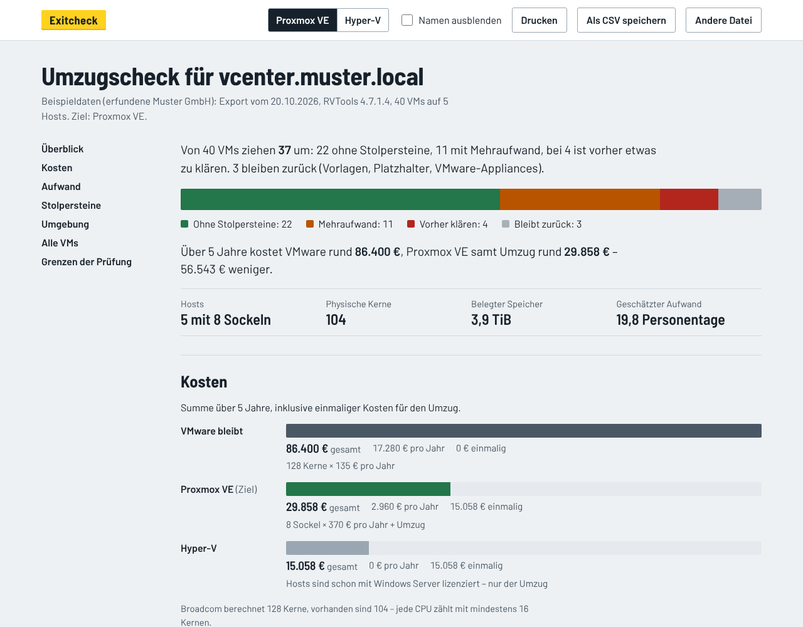

# Exitcheck

**Was kostet der Abschied von VMware – und was steht ihm im Weg?**

Exitcheck liest einen Export des kostenlosen Inventarwerkzeugs [RVTools](https://www.dell.com/support/kbdoc/de-de/000325532/rv-4-8-1) und zeigt in wenigen Sekunden:

- **Kosten:** Broadcom-Lizenz nach Kernen gegen Proxmox-VE-Subskription nach Sockeln und Hyper-V, über einen frei wählbaren Zeitraum und inklusive Umzug
- **Stolpersteine:** für jede VM, was den Umzug verhindert oder Mehrarbeit macht
- **Aufwand:** eine nachvollziehbare Schätzung in Personentagen und die reine Kopierzeit für die vorhandene Datenmenge

**Ausprobieren:** <https://uekala.github.io/exitcheck/> – mit eigenem Export oder den eingebauten Beispieldaten.



## Ihre Daten bleiben bei Ihnen

Exitcheck ist eine einzige HTML-Datei. Sie rechnet vollständig im Browser, lädt nichts nach und sendet nichts. Das ist technisch abgesichert: Die Content-Security-Policy der Seite verbietet jede Netzwerkverbindung (`connect-src 'none'`) und lässt nur das eingebettete Skript zu.

Wer ganz sicher gehen will, speichert die Seite (Link unten auf der Seite) und öffnet sie ohne Internet.

**Namen ausblenden** ersetzt VM-, Host-, Cluster-, Datastore- und Netzwerknamen durch neutrale Bezeichnungen – im Bericht, beim Drucken und im CSV-Export. So lässt sich ein Ergebnis weitergeben, ohne die Umgebung offenzulegen. Lizenzschlüssel liest Exitcheck gar nicht erst ein.

## So entsteht der Export

1. RVTools auf einem Windows-Rechner starten und mit vCenter oder einem ESXi-Host verbinden.
2. Im Menü *File* den Punkt *Export all to Excel* wählen.
3. Die Datei in Exitcheck ablegen.

Auch die CSV-Dateien von *Export all to csv* funktionieren. Bei mehreren vCentern einfach alle Exporte zusammen ablegen.

## Was geprüft wird

| Befund | Proxmox VE | Hyper-V |
|--------|------------|---------|
| Verschlüsselte VM | vorher klären | vorher klären |
| Fault Tolerance aktiv | vorher klären | vorher klären |
| Raw Device Mapping, physisch | vorher klären | vorher klären |
| Raw Device Mapping, virtuell | Mehraufwand | Mehraufwand |
| Gemeinsam genutzte Disk (Cluster) | vorher klären | vorher klären |
| DirectPath I/O oder SR-IOV | vorher klären | vorher klären |
| Durchgereichtes USB-Gerät (z. B. Lizenzdongle) | Mehraufwand | vorher klären |
| Snapshots, Konsolidierung nötig | Mehraufwand | Mehraufwand |
| Disks auf vSAN | Mehraufwand | – |
| Virtuelles TPM | Mehraufwand | Mehraufwand |
| Altes Windows ohne aktuelle VirtIO-Treiber | Mehraufwand | – |
| VM nicht erreichbar (verwaist) | Mehraufwand | Mehraufwand |
| Betriebssystem ohne oder bald ohne Support, UEFI/Secure Boot, Netzwerkkarten unter Linux, verbundene CD/DVD, Latenzempfindlichkeit, ausgeschaltete VMs, Sonderzeichen im Datastore-Namen | Hinweis | Hinweis |

Vorlagen, SRM-Platzhalter und VMware-Appliances wie vCenter werden erkannt und nicht mitgezählt.

Für die Umgebung meldet Exitcheck außerdem das Supportende der ESXi-Versionen, Hosts mit weniger als 16 Kernen pro CPU (Broadcom berechnet trotzdem 16), Cluster mit zwei Hosts (Proxmox braucht dann ein QDevice), wegfallendes vSAN und die Zahl der neu anzulegenden Netze.

Grundlage für Proxmox ist vor allem die Anleitung [Migrate to Proxmox VE](https://pve.proxmox.com/wiki/Migrate_to_Proxmox_VE).

## Kostenmodell

Alle Preise sind Vorgaben, die sich im Bericht ändern lassen – am besten durch das eigene Angebot.

| Posten | Vorgabe | Grundlage |
|--------|---------|-----------|
| VMware | 135 € je Kern und Jahr (VVF), mindestens 16 Kerne je CPU | Broadcom veröffentlicht keine Preisliste; berichtete US-Listenpreise: VCF 350, VVF 135, vSphere Standard 50 |
| Mindestmenge VMware | 0 Kerne | Händler nannten 2025 teils 72 Kerne; Broadcom bestätigt das öffentlich nicht |
| Proxmox VE | 370 € je Sockel und Jahr (Basic) | [offizielle Preise](https://www.proxmox.com/proxmox-ve/pricing), Stand Oktober 2026 |
| Hyper-V | keine Zusatzkosten, wenn die Hosts wegen Windows-VMs schon mit Windows Server lizenziert sind; sonst Windows Server Standard, 74 € je Kern einmalig | US-Listenpreis 1.176 $ je 16 Kerne |
| Umzug | 95 € je Stunde | Median IT-Infrastruktur im Freelancer-Kompass 2026 |

Nicht enthalten sind Hardware, Backup-Software, Schulung und laufender Betrieb. Windows-Lizenzen für Windows-VMs braucht jede Variante; sie sind deshalb nicht eingerechnet.

## Grenzen

Exitcheck sieht nur, was RVTools exportiert. Anwendungen und ihre Abhängigkeiten, an Hardware gebundene Lizenzen in den VMs, das Backup-Konzept und die Eignung von Hardware und Netz bleiben außen vor. Fehlen im Export Blätter oder Spalten (etwa die vTPM-Angabe bei älteren RVTools-Versionen), sagt der Bericht das ausdrücklich.

Ergebnisse sind Schätzungen ohne Gewähr.

## Entwicklung

Ohne Abhängigkeiten zur Laufzeit: Der xlsx-Leser ist Teil des Projekts und nutzt nur `DecompressionStream`, das Browser und Node mitbringen.

```bash
npm test                       # Tests mit node:test (Node 22)
npm run build                  # baut dist/index.html
node tests/browser.e2e.mjs     # Browser-Test, braucht Playwright
python3 tools/make_example.py  # erzeugt die erfundenen Beispieldaten neu (openpyxl)
```

Der Quellcode liegt als ES-Module in `src/`; `tools/build.mjs` setzt sie mit Stylesheet, Schriften und Beispieldaten zu einer Datei zusammen und berechnet die Hashes für die Content-Security-Policy.

## English

Exitcheck analyses an RVTools export entirely in the browser and compares VMware (Broadcom per-core subscription) with Proxmox VE and Hyper-V, lists migration blockers per VM and estimates the effort. No data leaves the machine: the page is a single HTML file whose Content-Security-Policy forbids all network connections. The interface is in German.

## Lizenz

MIT – siehe [LICENSE](LICENSE). Die Schrift Barlow steht unter der SIL Open Font License ([assets/fonts/OFL.txt](assets/fonts/OFL.txt)).

Kein Angebot von Broadcom, Microsoft, Proxmox oder Dell. VMware, vSphere, Hyper-V, Proxmox und RVTools sind Marken ihrer Inhaber.
